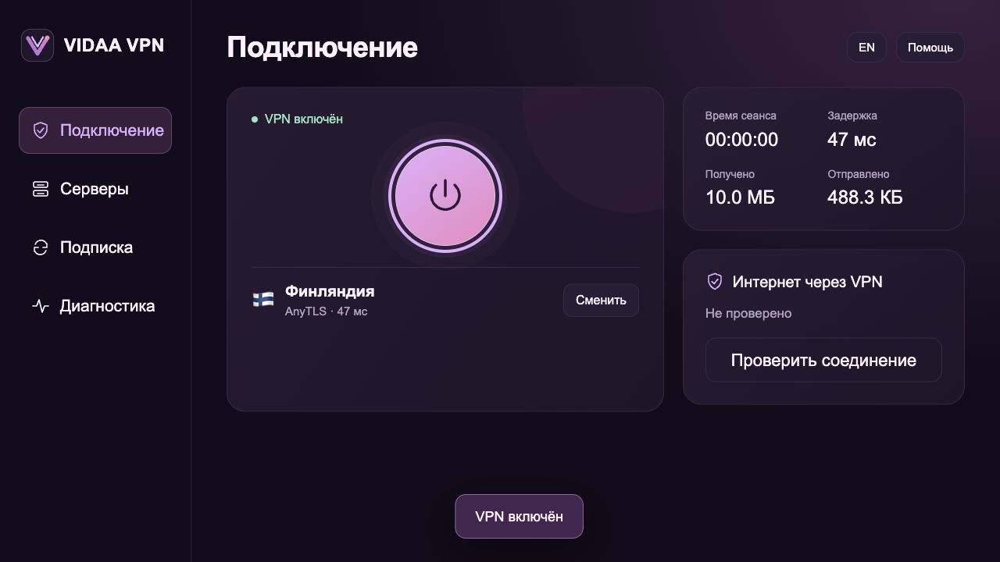
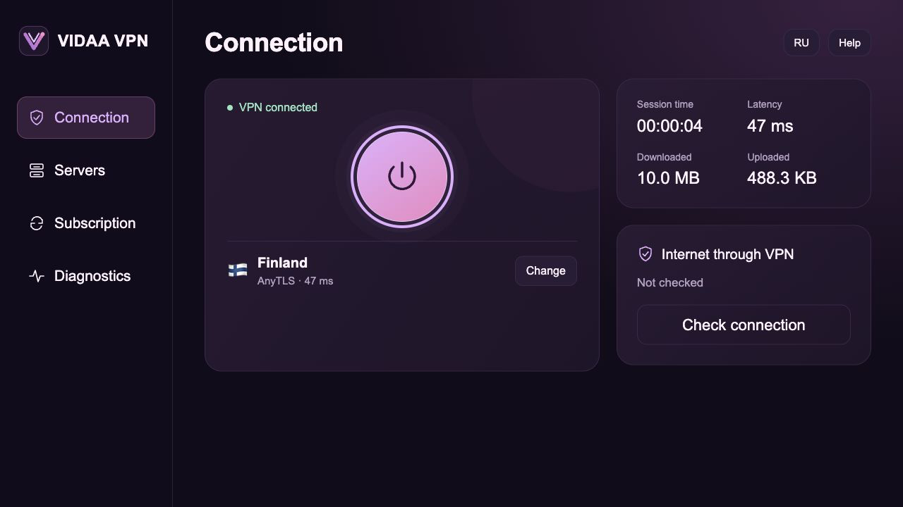

<p align="center"></p>
<h1 align="center">VIDAA VPN</h1>
<p align="center">A lightweight, remote-friendly VPN client for compatible VIDAA televisions.</p>
<p align="center"><a href="README.ru.md">Русский</a> · <a href="docs/guide.en.md">Installation & user guide</a> · <a href="SECURITY.md">Security</a></p>

**VIDAA VPN is a VPN client for televisions running the VIDAA operating system.**
It connects the TV itself to your VPN server so TV applications, including
video apps, can use that connection.

There are many VPN clients, but standard Android TV apps cannot be installed
on VIDAA. This project is built specifically for VIDAA: the client runs directly
on a compatible television and is controlled with its existing remote.
There is no need to change the TV operating system, attach an Android box,
or configure VPN routing on your router.

Add your own subscription, choose a server and connect. The client supports
VLESS, AnyTLS, Naive and Mieru, server latency checks and subscription updates.
After installation, it runs without the computer. This project provides the
client; you supply the servers and subscription.

**Experimental public distribution.** The installation mechanism and runtime
architecture were exercised in a separate prototype. This cleaned public fork,
its new installation wizard and its changed resource names have **not yet been
end-to-end validated on a television**. Local tests and UI demos do not replace
that hardware test. Compatibility with all VIDAA models is not claimed.

This is an independent project, not an official VIDAA/Hisense application.
It does not install Android, replace firmware, or include a VPN subscription.

## Quick start

1. If a maintainer has published a tested installer in **Releases**, download the
   appropriate package, verify its checksum, extract it and run the installer.
2. Otherwise, download this repository, install **Python 3.10+**, and run
   `python3 install.py` (`py -3 install.py` on Windows). On macOS you can also
   open `install.command`; on Windows use `install.bat`.
3. The local wizard opens in your computer's browser. Enter the TV's private
   IPv4 address or use **Find TV**, select **English** or **Русский**, confirm
   that you are authorized to administer that device, then select **Prepare**.
4. Open the displayed address **in the TV's browser** and leave that page open.
5. After the wizard confirms success, fully restart the television and open
   **VIDAA VPN**. Add your own HTTPS subscription in **Subscription**.

Keep both devices on the same trusted private network. There is no command to
enter on the TV. The computer is only required for installation, updates and
removal. [Detailed instructions and troubleshooting →](docs/guide.en.md)

## Features

- Native ARM64 VPN engine integration; no Android virtual machine.
- VLESS with TLS/Reality, AnyTLS, Naive and Mieru profile support.
- Separate Russian and English interfaces, with an in-app language button.
- D-pad/OK/Back navigation, server selection, favourites and latency sorting.
- On-demand TCP endpoint checks, including progress and individual results.
- HTTPS subscription refresh, validation and preservation of the previous
  configuration when a refresh fails.
- Session duration, traffic counters and client memory statistics.
- Local configuration checks and an explicit VPN connectivity test.
- No embedded subscriptions, hard-coded device keys, analytics or external fonts.

The interface intentionally omits promotional cards, subscription-count banners
and persistent version/startup captions. A progress counter appears only while
checking endpoints.

## Compatibility and privileged access

The current installer targets a narrow class of modern MediaTek VIDAA firmware
with an AArch64 kernel, `/dev/net/tun`, Chromium 90+, Node 16+, the Phoenix service
layout used in this repository, and an installation service that permits the
explicit privileged package operation. Its package architecture is currently
`mtk9655`; this is **not** a universal VIDAA installer.

**Security-research / dual-use notice:** the setup package requests UID 0 through
a firmware-specific local installation mechanism. Root is required for the VPN
interface and network rules. Use only on a TV you own or are authorized to
administer. If the firmware rejects that operation, the installer must stop; it
does not bypass a locked bootloader, flash partitions or disable firmware
verification. Do not use the project to compromise other devices. See
[SECURITY.md](SECURITY.md) for vulnerability and abuse reporting.

Installation uses a temporary HTTP server on the selected LAN interface, restricted
to the selected TV address and an unpredictable session URL. This requires a
trusted LAN: it is not a defence against an active LAN attacker. Runtime control
uses the TV's HTTPS loopback service and a device-generated token.

## Preview without a TV

```sh
python3 tools/demo.py
```

Open `http://127.0.0.1:8780/ru/index.html` or
`http://127.0.0.1:8780/en/index.html`. Every endpoint, value and result in this demo
is synthetic. The demo does not contact or modify a television.

| Russian | English |
| --- | --- |
|  |  |

## Development and validation

No frontend framework or runtime npm dependencies are needed.

```sh
node --test tests/*.test.js
python3 -m unittest discover -s tests -p 'test_*.py'
python3 tools/privacy_check.py
python3 install.py --dry-run
```

[Architecture](docs/architecture.md) · [Privacy](PRIVACY.md) ·
[Contributing](CONTRIBUTING.md) · [Validation scope](docs/validation.md)

## Build a desktop installer

```sh
python3 -m venv .venv
# Activate the environment using the appropriate command for your OS.
python3 -m pip install -r requirements-build.txt
python3 tools/build_installer.py
```

The included GitHub Actions workflow builds platform-specific installers as
artifacts. It does not automatically create a public release or certify hardware
compatibility. A maintainer should hardware-test an artifact before publishing it.

## Limits and licensing

TCP ping measures connection establishment to an endpoint, not VPN throughput,
end-to-end tunnel health, or resistance to filtering. There is no always-on kill
switch, automatic startup, or guarantee of anonymity or undetectability by DPI /
TSPU. [Read the security model →](SECURITY.md)

Project code and original artwork: [MIT](LICENSE). External engines keep their
upstream licenses and are downloaded separately, with pinned checksums.
[Third-party notices and source links](THIRD_PARTY_NOTICES.md).
