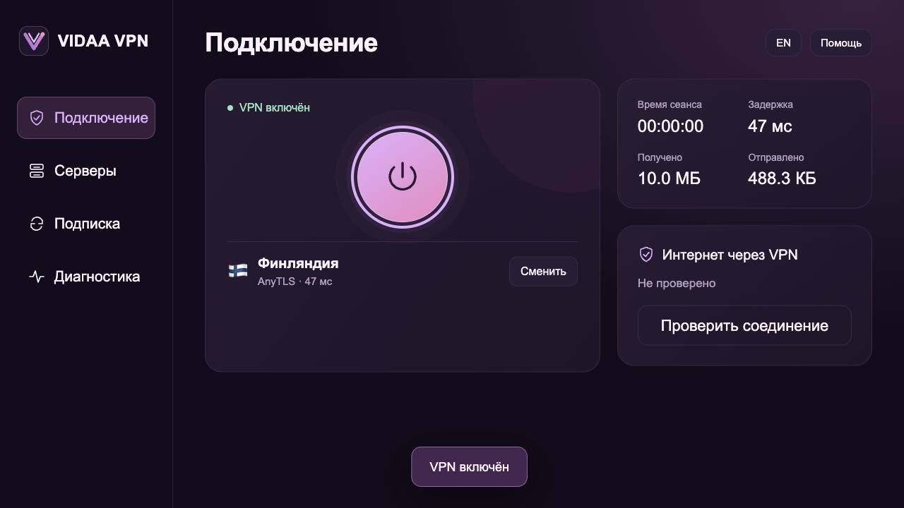
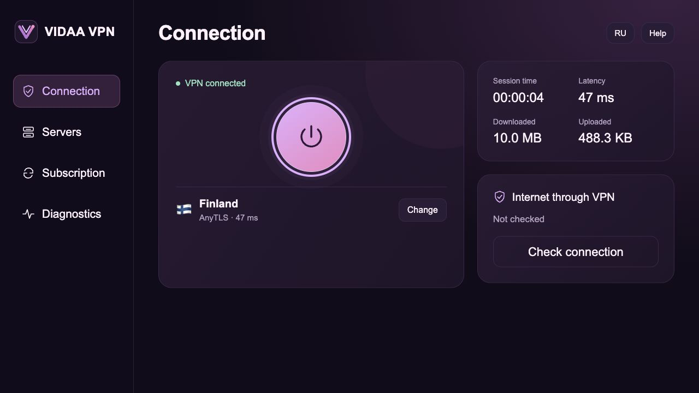

<p align="center"></p>
<h1 align="center">VIDAA VPN</h1>
<p align="center">Лёгкий VPN-клиент для совместимых телевизоров VIDAA с управлением с пульта.</p>
<p align="center"><a href="README.md">English</a> · <a href="docs/guide.ru.md">Установка и функции</a> · <a href="SECURITY.md">Безопасность</a></p>

**VIDAA VPN — VPN-клиент для телевизоров с операционной системой VIDAA.**
Он позволяет подключить сам телевизор к вашему VPN-серверу и пользоваться
соединением в приложениях ТВ, например при просмотре видео.

VPN-клиентов много, но обычные приложения для Android TV не устанавливаются
на VIDAA. Этот проект создан именно для VIDAA: клиент запускается прямо
на совместимом телевизоре, а интерфейс управляется штатным пультом.
Менять ОС, подключать Android-приставку или настраивать VPN на роутере не требуется.

Добавьте свою подписку, выберите сервер и включите VPN. Доступны VLESS,
AnyTLS, Naive и Mieru, проверка задержки серверов и обновление подписки.
После установки компьютер для работы VPN не нужен. Проект предоставляет
клиент; серверы и подписку вы подключаете самостоятельно.

**Экспериментальная публичная версия.** Механизм установки и архитектура проверялись
в отдельном прототипе. Именно этот очищенный публичный проект, его новый мастер
и изменённые имена ресурсов **пока не прошли сквозную установку на телевизоре**.
Локальные тесты и демонстрация интерфейса не заменяют проверку на оборудовании.
Совместимость со всеми моделями VIDAA не заявляется.

Это независимый проект, не официальное приложение VIDAA/Hisense. Он не устанавливает
Android, не заменяет прошивку и не содержит готовой VPN-подписки.

## Быстрая установка

1. Если сопровождающий уже опубликовал проверенный установщик в **Releases**,
   скачайте пакет для своей ОС, проверьте контрольную сумму, распакуйте и запустите.
2. Если готового выпуска ещё нет, скачайте исходники, установите **Python 3.10+**
   и запустите `python3 install.py` (`py -3 install.py` в Windows). На macOS также
   можно открыть `install.command`, в Windows — `install.bat`.
3. В браузере компьютера откроется мастер. Введите локальный IPv4 телевизора или
   нажмите **Найти телевизор**, выберите язык приложения и подтвердите право
   администрировать устройство. Нажмите **Подготовить**.
4. Откройте показанный адрес **в браузере телевизора** и оставьте страницу открытой.
5. После сообщения об успехе полностью перезагрузите ТВ, откройте **VIDAA VPN**
   и добавьте свою HTTPS-подписку в разделе **Подписка**.

Оба устройства должны находиться в одной доверенной домашней сети. Команды на
телевизоре вводить не нужно. Компьютер требуется только для установки, обновления
и удаления. [Краткая инструкция со скриншотами →](docs/guide.ru.md)

## Возможности

- Нативный ARM64-клиент без Android и виртуальной машины.
- Профили VLESS с TLS/Reality, AnyTLS, Naive и Mieru.
- Русская и английская версии с переключением языка внутри приложения.
- Стрелки / OK / Назад, выбор сервера, избранное и сортировка по задержке.
- TCP-пинг серверов по запросу с прогрессом и отдельными результатами.
- Обновление HTTPS-подписки с проверкой и сохранением старых настроек при ошибке.
- Время сеанса, счётчики трафика и память VPN-клиента.
- Проверка параметров защиты и доступа к интернету через VPN.
- Без встроенных подписок, ключей конкретного устройства, аналитики и внешних шрифтов.

Из интерфейса убраны рекламные карточки, баннеры с числом серверов и постоянные
служебные подписи с версией и режимом запуска. Счётчик остаётся только на время
проверки серверов, чтобы показывать прогресс.

## Совместимость и привилегии

Установщик рассчитан на ограниченный класс современных прошивок MediaTek VIDAA:
ядро AArch64, `/dev/net/tun`, Chromium 90+, Node 16+, используемая здесь структура
служб Phoenix и разрешённая прошивкой привилегированная установка. Архитектура
пакетов сейчас указана как `mtk9655`; это **не универсальный установщик для VIDAA**.

**Уведомление об исследовательском / двойном назначении:** установочный пакет
запрашивает UID 0 через зависящий от прошивки локальный механизм установки. Эти
права нужны для туннеля и сетевых правил. Используйте проект только на своём
телевизоре или с разрешения владельца. Если прошивка отклоняет операцию, установка
должна остановиться. Проект не разблокирует загрузчик, не прошивает разделы и не
отключает проверку прошивки. Не используйте его для доступа к чужим устройствам.
Способ сообщения об уязвимостях и злоупотреблениях указан в [SECURITY.md](SECURITY.md).

Установка временно использует HTTP-сервер на выбранном интерфейсе домашней сети,
ограниченный IP телевизора и случайным адресом сеанса. Нужна доверенная сеть:
от активного атакующего внутри LAN этот механизм не защищает. Работающее
приложение управляется через HTTPS loopback-службу ТВ и ключ, созданный на телевизоре.

## Посмотреть интерфейс без ТВ

```sh
python3 tools/demo.py
```

Откройте `http://127.0.0.1:8780/ru/index.html` или
`http://127.0.0.1:8780/en/index.html`. Серверы, числа и результаты демонстрации
вымышленные. Демонстрация не обращается к телевизору.

| Русский | English |
| --- | --- |
|  |  |

## Проверки и сборка

Фреймворк и runtime-зависимости npm для интерфейса не нужны.

```sh
node --test tests/*.test.js
python3 -m unittest discover -s tests -p 'test_*.py'
python3 tools/privacy_check.py
python3 install.py --dry-run
```

Для сборки установщика создайте виртуальное окружение Python, установите
`requirements-build.txt` и запустите `python3 tools/build_installer.py`. Workflow
GitHub Actions собирает пакеты для разных ОС в артефакты, но не публикует релиз
автоматически и не подтверждает совместимость с ТВ. Перед публикацией нужна
проверка собранного пакета на реальном оборудовании.

[Архитектура](docs/architecture.md) · [Приватность](PRIVACY.md) ·
[Участие в проекте](CONTRIBUTING.md) · [Объём проверки](docs/validation.md)

## Ограничения и лицензии

TCP-пинг не является замером скорости, проверкой всего туннеля или доказательством
незаметности. Постоянный kill switch и автозапуск не реализованы. Гарантий анонимности
или нераспознаваемости DPI / ТСПУ нет. [Модель безопасности →](SECURITY.md)

Наш код и новый логотип: [MIT](LICENSE). Внешние движки имеют собственные лицензии,
скачиваются отдельно и проверяются по SHA-256.
[Уведомления и ссылки на исходники](THIRD_PARTY_NOTICES.md).
