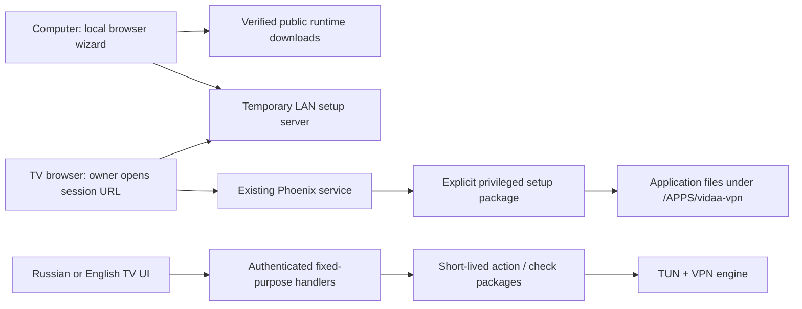

# Architecture

The PC wizard binds to loopback and authorizes its control requests with a random
per-run key. Its separate temporary LAN server binds to the selected computer
interface, accepts only the chosen TV IPv4, has a random URL and expires. Its
payload does not contain the user's subscription or device control token.

The firmware-specific package requests UID 0. It verifies checksums, refuses an
unowned application directory, preserves existing profile data on an update,
creates a fresh TV token only for a new installation, and registers a PNG-backed
launcher entry. It does not write firmware partitions. Temporary staging and its
setup package are removed after verification.

The UI is plain HTML/CSS/JavaScript with two dictionaries. The native view renderer
inserts a control token into a response meta tag and serves whitelisted static
assets. It restricts origins, frames and scripts with response headers. The native
asset handler cannot read arbitrary files. Demo HTML contains no live token.

Authenticated UI actions map to fixed root capsules. There is no caller-provided
shell command, executable path or general file API. Subscription input is parsed
into a supported-field whitelist. The root action validates a candidate before
committing it and attempts rollback on a failed active switch.

Resources: `vvpn0`, routing table `22032`, rule priorities `29100–29110`, and filter
chain `VIDAA_VPN_IN`. Runtime ownership markers guard cleanup. A free virtual IPv4
prefix is selected from fixed candidates after checking connected interfaces.
Mieru's SOCKS sidecar is loopback-only on port `18988`, with its management RPC
disabled. No daemon is added for boot-time automatic startup.

`probe-root.js` and `security-root.js` are bounded, short-lived jobs. The first
measures TCP establishment, not tunnel speed. The second reads configuration and
optionally tests HTTPS connectivity. Reports expose result flags and opaque IDs,
not endpoint credentials. Traffic/memory status excludes the overall TV browser
and unrelated firmware processes.

The bootstrap privilege path is a platform trust assumption. Application token
checks do not make a compromised firmware or local privileged service trustworthy.
See `SECURITY.md` and the guide for limits and operational requirements.
