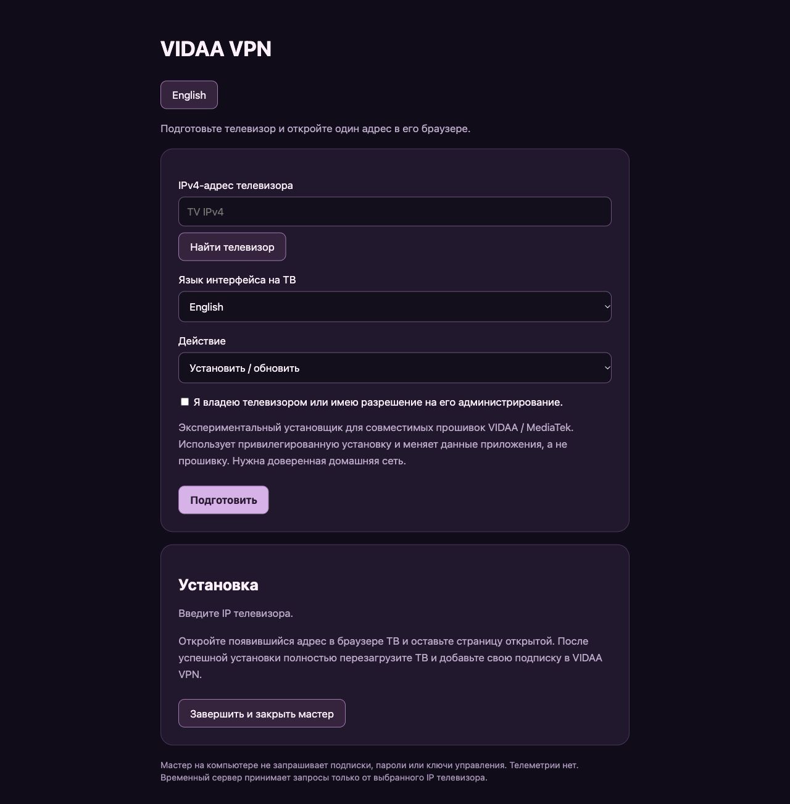
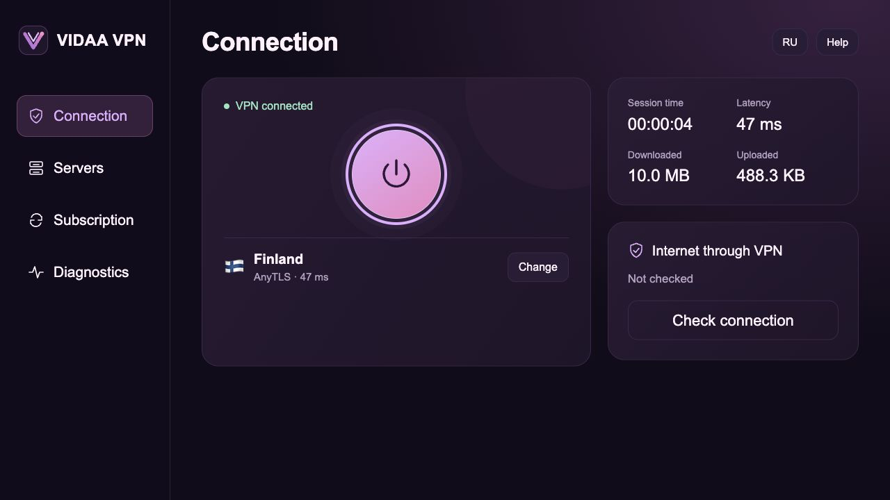

# VIDAA VPN: setup and use

[Русский](guide.ru.md) · [About the project](../README.md)

VIDAA VPN connects a television running VIDAA to your VPN server. The client runs
on the TV and uses its remote: add a subscription, select a server and connect
TV applications through VPN. No OS replacement or separate TV box is needed.

**Experimental:** this public installer has not yet completed an end-to-end TV
hardware test. It requires compatible MediaTek VIDAA firmware with the expected
Phoenix services and privileged installation support; package architecture is
`mtk9655`. Not all VIDAA televisions are supported.

## 1. Prepare your devices

You need a computer and TV on the same trusted home network, internet access on
the computer, your own HTTPS VPN subscription URL and approximately 300 MB of free
TV application storage for installation. Only administer a TV you own or have
permission to manage. The installer changes application data, not firmware.

## 2. Start the computer wizard

Download and extract the project. Install Python 3.10+ if needed.

- **macOS:** run `python3 install.py` in a terminal from the project folder.
- **Windows:** open `install.bat`.
- **Linux:** run `python3 install.py` from the project folder.

Alternatively, run `py -3 install.py` on Windows from the project folder.
If Releases contains a tested installer for your OS, you can use it instead of
Python: verify its SHA-256, extract it and launch it.

## 3. Prepare the installation

In the wizard:

1. Enter the TV IPv4 from **Settings → Network → Connection status** (menu names
   vary) or select **Find TV**.
2. Choose the TV interface language and **Install / update**.
3. Confirm that you are authorized to administer the TV, then select **Prepare**.

The wizard downloads components and verifies their checksums. Keep it running.
You do not enter your subscription on the computer.

The wizard supports both languages; this screenshot shows the Russian view with
empty fields.

## 4. Open the setup address on the TV

Open the TV's built-in browser and type **the address displayed by your wizard**.
Leave the page open until installation succeeds. Fully restart the TV, open
**VIDAA VPN** from the application list, and finish the computer wizard. Standby
is not a full restart.

Setup uses local HTTP, so use a trusted network. Do not expose ports to the
internet. If firmware denies installation, stop.

## 5. Add a subscription and connect

Open **Subscription → New subscription URL**, enter your own HTTPS URL and select
**Save and refresh**. Choose a profile in **Servers**, return to **Connection**
and press the round power button.

Supported protocols are VLESS with TLS/Reality, AnyTLS, Naive and single-port Mieru.
Subscription formats are share-link lists, Base64 lists and supported JSON
`outbounds`. Clash YAML and arbitrary configurations are not imported.

## Main functions

| Section / control | Action |
| --- | --- |
| Connection | Connect/disconnect, session time and traffic counters |
| Servers | Profile selection, protocol filters, favourites and sorting |
| TCP ping | TCP connection timing; not a speed test or proof that the VPN works |
| Subscription → Refresh | Download servers using the saved URL |
| Subscription → Save and refresh | Replace the subscription URL |
| Diagnostics | Check configuration, client memory and internet access through VPN |
| RU / EN | Switch the currently open interface language |

**Remote:** arrows move focus, **OK** selects, and **Back** closes a dialog or
returns to the main screen. VPN keeps running when you leave its interface;
the computer is no longer needed. After a full TV restart, connect manually.
There is no always-on kill switch or guarantee of DPI/TSPU invisibility.

## Update or remove

Run the wizard again. **Install / update** preserves the subscription when
updating; **Remove app and its data** removes its data. Open the new setup address
on the TV and wait for completion. Reconnect manually after updating. To change
the launcher language, select the desired language during an update.

## Troubleshooting

| Problem | What to do |
| --- | --- |
| TV cannot open the address | Check the TV IP, same LAN, current URL and computer firewall access on the private network |
| Missing application icon | Fully restart the TV and check the complete application list |
| `PLATFORM_UNSUPPORTED`, `INSTALLER_DENIED`, `ROOT_REQUIRED` | Firmware is incompatible or denies installation; stop |
| `CHECKSUM_FAILED` | Retry the official download; do not disable verification |
| No servers | Check subscription format and supported profiles |
| Ping works but video fails | Connect, run Diagnostics and try another server |

Never post subscriptions, passwords, keys or raw device reports in Issues.
Read more about [privacy](../PRIVACY.md), [security](../SECURITY.md) and
[compatibility](../README.md#compatibility-and-privileged-access).
