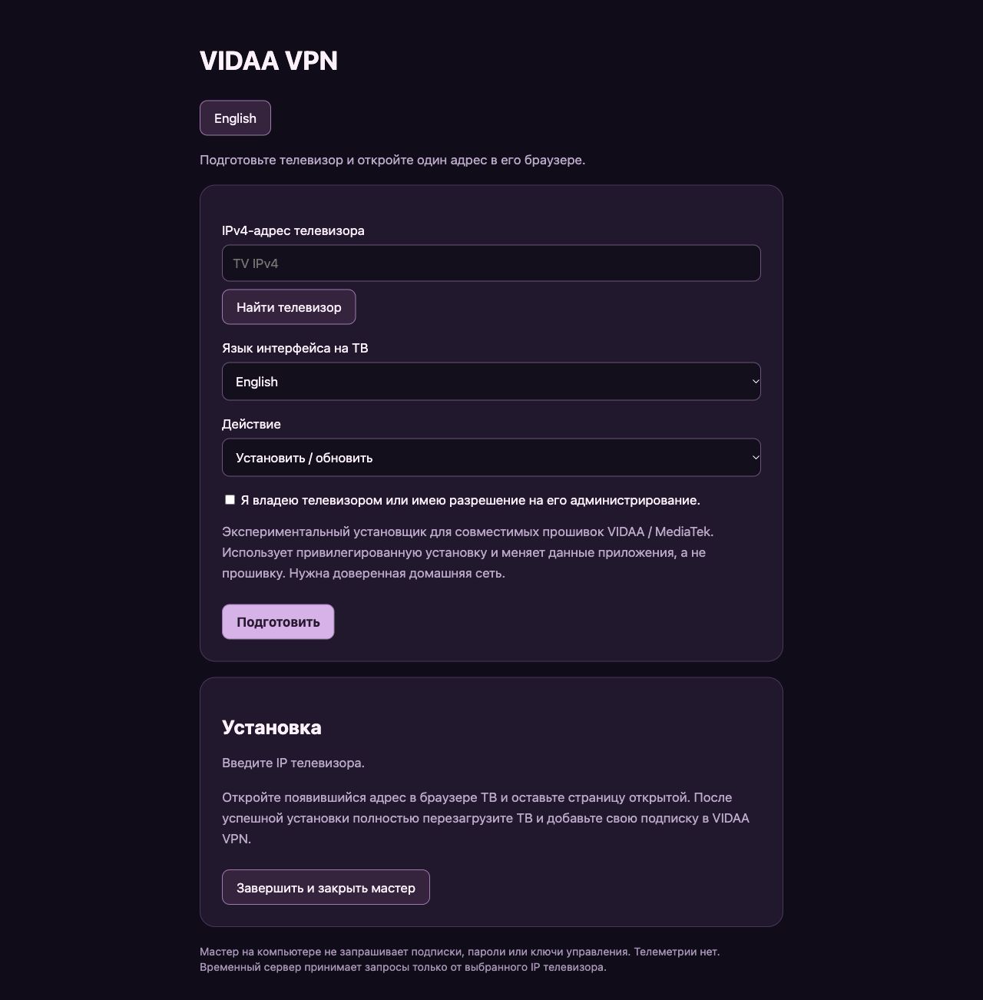
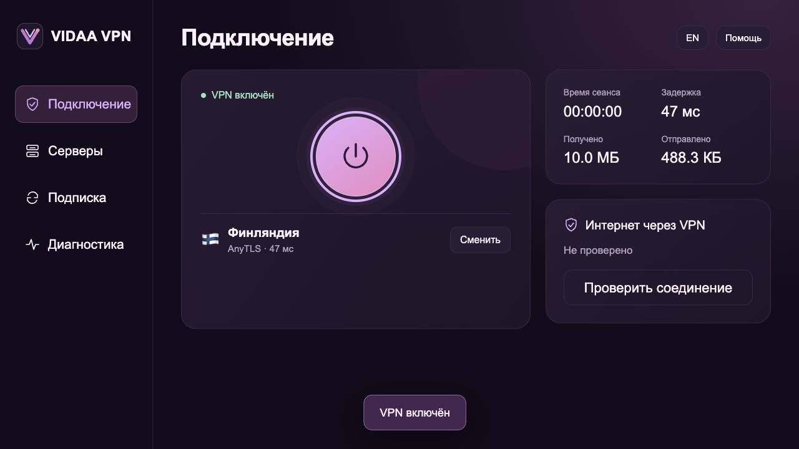

# VIDAA VPN: установка и использование

[English](guide.en.md) · [О проекте](../README.ru.md)

VIDAA VPN подключает телевизор с ОС VIDAA к вашему VPN-серверу. Клиент работает
на самом ТВ и управляется пультом: добавьте подписку, выберите сервер и включите
соединение для приложений телевизора. Замена ОС и отдельная приставка не нужны.

**Экспериментальная версия:** этот публичный установщик ещё не прошёл полную
проверку на телевизоре. Поддерживаются только совместимые прошивки MediaTek VIDAA
с необходимыми службами Phoenix и привилегированной установкой; архитектура пакета
— `mtk9655`. Совместимость со всеми телевизорами VIDAA не заявляется.

## 1. Подготовьте устройства

Нужны компьютер и телевизор в одной доверенной домашней сети, интернет на
компьютере, своя HTTPS-ссылка VPN-подписки и примерно 300 МБ свободного места
на ТВ для установки. Используйте только свой телевизор или разрешение владельца.
Установщик меняет данные приложения, а не прошивку.

## 2. Запустите мастер на компьютере

Скачайте и распакуйте проект. Установите Python 3.10+, если его ещё нет.

- **macOS:** в терминале в папке проекта выполните `python3 install.py`.
- **Windows:** откройте `install.bat`.
- **Linux:** в папке проекта выполните `python3 install.py`.

Альтернатива для Windows — `py -3 install.py` в терминале в папке проекта.
Если в Releases опубликован проверенный установщик для вашей ОС, можно использовать
его вместо Python: проверьте SHA-256, распакуйте и запустите.

## 3. Подготовьте установку

В открывшемся мастере:

1. Введите IPv4 телевизора из **Настройки → Сеть → Состояние подключения**
   (названия могут отличаться) или нажмите **Найти телевизор**.
2. Выберите язык приложения и действие **Установить / обновить**.
3. Подтвердите право администрировать ТВ и нажмите **Подготовить**.

Мастер скачает компоненты и проверит их контрольные суммы. Оставьте его запущенным.
Ссылка подписки на этом этапе не нужна.

## 4. Откройте ссылку на телевизоре

Откройте встроенный браузер ТВ и введите **адрес, показанный вашим мастером**.
Не закрывайте страницу до сообщения об успешной установке. Затем полностью
перезагрузите телевизор, откройте **VIDAA VPN** в списке приложений и завершите
мастер на компьютере. Режим ожидания не заменяет перезагрузку.

Передача установки идёт по локальному HTTP, поэтому нужна доверенная сеть.
Не открывайте порты в интернет. Если установка отклонена прошивкой, остановитесь.

## 5. Добавьте подписку и подключитесь

Откройте **Подписка → Новая ссылка подписки**, введите свою HTTPS-ссылку и нажмите
**Сохранить и обновить**. Затем в **Серверах** выберите профиль, вернитесь в
**Подключение** и нажмите круглую кнопку питания.

Поддерживаются VLESS с TLS/Reality, AnyTLS, Naive и однопортовые профили Mieru.
Форматы подписки: список share-ссылок, Base64 или поддерживаемый JSON `outbounds`.
Clash YAML и произвольные конфигурации не импортируются.

## Основные функции

| Раздел / кнопка | Действие |
| --- | --- |
| Подключение | Включение и выключение VPN, время сеанса и трафик |
| Серверы | Выбор профиля, фильтр протокола, избранное и сортировка |
| TCP-пинг | Проверка времени TCP-соединения; это не проверка скорости или работы VPN |
| Подписка → Обновить | Загрузка серверов по сохранённой ссылке |
| Подписка → Сохранить и обновить | Замена ссылки подписки |
| Диагностика | Проверка конфигурации, памяти клиента и доступа через VPN |
| RU / EN | Переключение языка текущего интерфейса |

**Пульт:** стрелки перемещают фокус, **OK** выбирает, **Назад** закрывает диалог
или возвращает на главный экран. VPN работает после выхода из приложения;
компьютер для этого не нужен. После полной перезагрузки ТВ включите VPN вручную.
Всегда включённого kill switch нет; невидимость для DPI/ТСПУ не гарантируется.

## Обновление и удаление

Повторно запустите мастер. **Установить / обновить** обновляет приложение с
сохранением подписки; **Удалить приложение и его данные** удаляет его данные.
Откройте новую ссылку на ТВ и дождитесь завершения. После обновления подключитесь
вручную. Для смены языка ярлыка выберите нужный язык при обновлении.

## Если что-то не работает

| Проблема | Что сделать |
| --- | --- |
| ТВ не открывает ссылку | Проверьте IP, одну сеть, актуальную ссылку и firewall компьютера для частной сети |
| Значок не появился | Полностью перезагрузите ТВ и проверьте общий список приложений |
| `PLATFORM_UNSUPPORTED`, `INSTALLER_DENIED`, `ROOT_REQUIRED` | Установка несовместима или запрещена прошивкой; остановитесь |
| `CHECKSUM_FAILED` | Повторите официальную загрузку, не отключайте проверку |
| Нет серверов | Проверьте формат подписки и наличие поддерживаемых профилей |
| Пинг есть, видео не работает | Подключите VPN, выполните диагностику и проверьте другой сервер |

Не публикуйте ссылку подписки, пароли, ключи или сырые отчёты в Issues.
Подробнее: [приватность](../PRIVACY.md), [безопасность](../SECURITY.md),
[совместимость](../README.ru.md#совместимость-и-привилегии).
